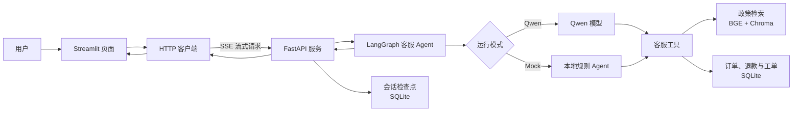

# 星河商城 Agent 客服

基于 LangGraph、FastAPI 和 Streamlit 的文字客服，保留政策检索、订单查询、退款资格判断、人工确认工单和会话恢复。支持真实 Qwen 工具调用及无需模型 API 的 Mock 模式，订单、工单与会话使用 SQLite。

## 架构



核心流程：政策问题进入本地知识库检索；订单与退款请求先完成身份校验；创建工单会暂停等待用户确认；对话状态保存在 SQLite，支持后续恢复。

## 本地运行

安装 Python 3.12+ 和 [uv](https://docs.astral.sh/uv/getting-started/installation/)，在仓库根目录执行：

```sh
uv sync --frozen
```

复制 `.env.example` 为 `.env`（Linux/macOS：`cp .env.example .env`；PowerShell：`Copy-Item .env.example .env`）。默认 `CUSTOMER_SUPPORT_MODE=mock`，无需模型密钥。

在两个终端分别启动后端和页面，工作目录都使用仓库根目录：

```sh
uv run python src/run_service.py
```

```sh
uv run streamlit run src/streamlit_app.py
```

打开 <http://127.0.0.1:8501>；API 文档为 <http://127.0.0.1:8080/docs>。两个终端按 `Ctrl+C` 停止。

可直接尝试：

- `查询订单 ORD1001，手机号后四位 8821`：演示订单运输中。
- `订单 ORD1002，手机号后四位 8821，能退款吗`：符合演示退款规则。
- `订单 ORD1003，手机号后四位 8821，能退款吗`：超过退款期限。
- `为订单 ORD1001 创建物流异常工单，手机号后四位 8821`：收到确认提示后回复“确认”或“取消”。
- `七天无理由退款需要满足什么条件`：检索政策知识库。

Mock 的订单、退款与工单流程不依赖外部模型；政策检索仍使用本地 BGE + Chroma，首次运行需要下载嵌入模型，之后复用 `data/models/` 缓存。Mock 用于验证固定业务流程，回答能力有限。

## 使用 Qwen

在 `.env` 中设置以下配置并重启后端：

```dotenv
CUSTOMER_SUPPORT_MODE=qwen
DASHSCOPE_API_KEY=你的密钥
DASHSCOPE_BASE_URL=https://dashscope.aliyuncs.com/compatible-mode/v1
DASHSCOPE_MODEL=qwen-plus
```

按阿里云工作空间要求调整 URL 和模型名称。`auto` 模式有 Key 时使用 Qwen，否则使用 Mock；`qwen` 模式要求有效配置。`.env` 不进入版本控制。

## Docker

准备 `.env` 后执行：

```sh
docker compose up --build -d
```

页面端口仍为 8501，API 为 8080。Compose 仅运行后端和文字页面；命名卷保存 SQLite 数据、Chroma 索引及模型缓存，`docker compose down` 停止服务并保留数据。

## 代码与数据

| 路径 | 职责 |
| --- | --- |
| `src/agents/` | Qwen / Mock 客服图、工具路由与工单审批 |
| `src/customer_support/` | 政策 RAG、SQLite 订单工单及退款规则 |
| `src/service/` | FastAPI、SSE、鉴权、历史与中断恢复 |
| `src/client/`、`src/streamlit_app.py` | HTTP 客户端和文字页面 |
| `src/core/`、`src/schema/`、`src/memory/` | 配置、消息协议与 SQLite checkpoint |
| `data/policies/` | 可编辑的示例政策；修改后检索时更新索引 |
| `data/evaluation/` | 固定评测用例 |
| `tests/`、`scripts/` | 回归测试与两项评测入口 |

默认会话文件为 `data/checkpoints.db`，订单和工单文件为 `data/customer_support.db`。页面提供会话恢复链接；恢复时依赖同一后端保存的 checkpoint。

## 验证

```sh
uv run pytest
uv run ruff check
uv run mypy src/
uv run python scripts/evaluate_agent.py
uv run python scripts/evaluate_rag.py
```

Agent 评测使用临时 SQLite 库验证路由、退款、身份校验和工单幂等；RAG 评测比较 lexical、dense 和 hybrid，首次需要下载模型。评测会覆盖对应 `data/evaluation/*_report.json`。报告仅覆盖固定演示用例。

## 来源与边界

基于 [agent-service-toolkit](https://github.com/JoshuaC215/agent-service-toolkit) 改造，保留 [MIT 许可证与版权声明](LICENSE)。项目使用演示订单和简化退款规则，面向本地学习与开发。`AUTH_SECRET` 可启用 Bearer 鉴权；配置后页面与后端使用同一值。当前未进行生产环境验证。
